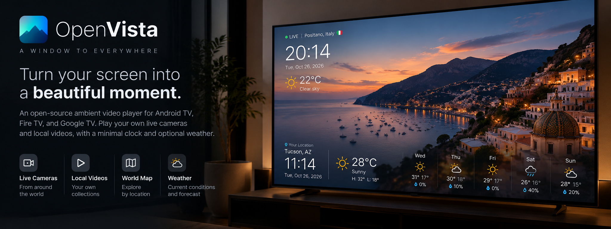
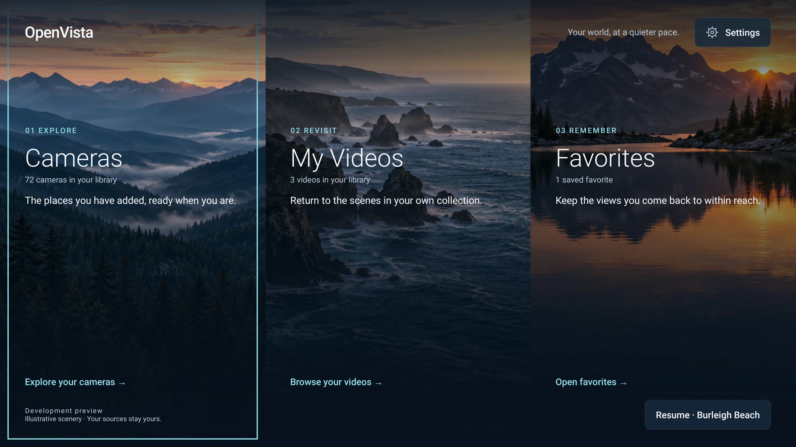
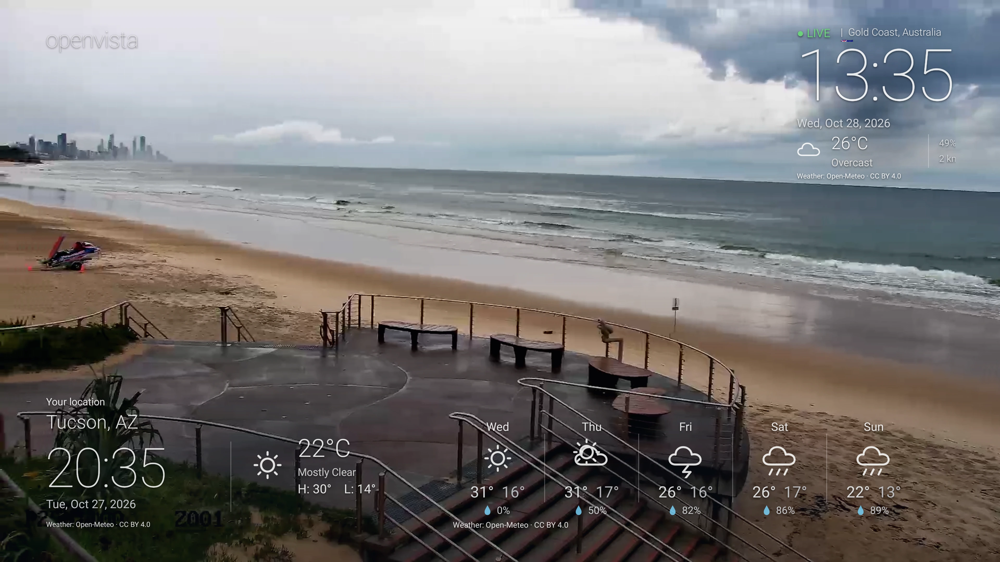
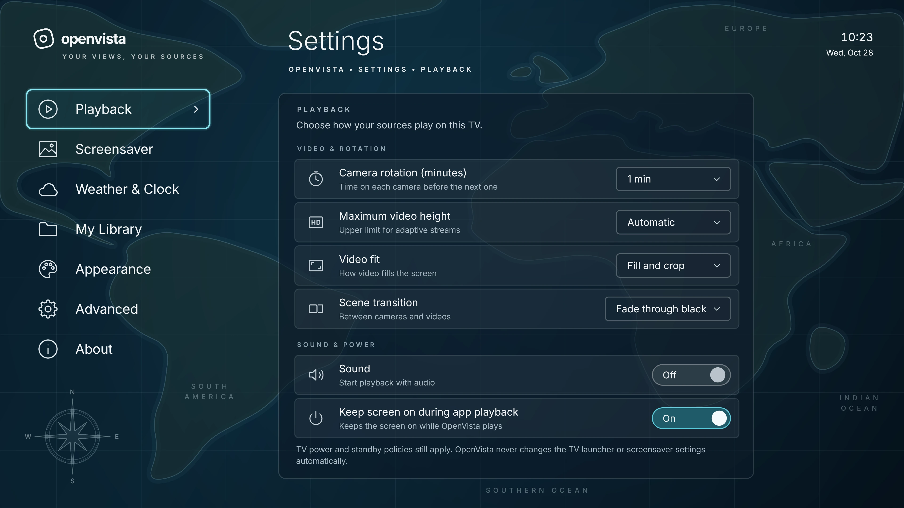

# OpenVista

**Your screen. Your scenery. Your moment.**

An open-source ambient video player built in Kotlin for Android TV, Fire TV, and potentially Google TV.

Play your own live cameras and local videos, with a minimal clock and optional weather.

[Status](docs/STATUS.md) · [Get started](#run-it-locally) · [Roadmap](docs/roadmap.md) · [Contributing](CONTRIBUTING.md) · [Product decisions](docs/product/decisions.md)

---

## See OpenVista on a real TV

These are **real screenshots from a Hisense 58U6HF running Fire OS 7**, not mockups. Captured directly from the development build on October 27, 2026, at 3840 × 2160, with the app set to English. The images were compressed for GitHub without altering the screens.

The featured live camera was added by the tester. **OpenVista does not include any streams, playlists, or videos.** The interface may change before release.

### Home

### Live camera playback

*Owner-added Burleigh Beach live feed with source-local time and weather alongside a separate viewer clock and forecast.*

### Settings

*Captured on the owner's Hisense Fire TV. The live feed is for demonstration only and is not bundled with OpenVista.*

---

## A window to somewhere you choose

OpenVista is for the moments when a television should feel like a window, not a wall of menus. Pick a live beach camera, a city skyline, or a video from your own collection. Let it play with only the information you want to see.

**You bring the content.** The app ships with **no camera streams, M3U playlists, videos, or hosted catalog**. Add a compatible HLS/MPEG-DASH URL, import your own M3U list, or select media from internal/USB storage. Research-only streams in this repository are **not** part of the APK.

## What's in the development build?

| Area | Implemented behavior | Evidence / limits |
| --- | --- | --- |
| TV experience | Three-card Home, Cameras, My Videos, Favorites, onboarding, remote-first menus, EN/PT-BR | Home, library and basic D-pad/picker flows observed on Hisense; full accessibility pass pending |
| Live sources | Manual HLS/DASH entry, user-selected M3U import, playlists, details, favorites | Live HLS/DASH 720p and M3U import observed on Hisense; other stream formats/quality need testing |
| Local videos | Scoped Android file/folder picker, recursive scan, persistence, playlists, player resume | MP4 and selected-folder restoration observed; physical USB removal/revocation and full codec matrix pending |
| Ambient playback | Media3 fullscreen player, camera rotation, local looping, muted default, overlays | Physical playback confirmed; long-run performance and recovery not certified |
| Weather | Free U.S. National Weather Service seven-day forecasts, hourly forecast condition, cache | Tucson forecast and on-video temperature observed; U.S. coverage only; no geocoding |
| Maps | Local metadata coordinates, schematic map and source list | A licensed map-tile provider is not active |
| System screensaver | Optional Android DreamService implementation | Fire OS idle activation / OEM compatibility not approved |
| Pairing and updates | Security-gated phone input and verified-update implementation | **Disabled** pending security, release channel and Android installer validation |

See [the dated verification ledger](docs/STATUS.md) and [Hisense device matrix](docs/testing/compatibility.md). A feature being coded does **not** mean it has passed stable-release acceptance.

## Run it locally

This repository currently contains Android app source and tests, **not a public release APK**.

Requirements: JDK 17, Android SDK (API 36), a compatible Android/Fire TV test device, and a supported Gradle environment. The Gradle wrapper is included.

On Windows, from the repository root:

    gradlew.bat :player:assembleDebug

To run the existing local validation:

    gradlew.bat :player:testDebugUnitTest :source-core:test :diagnostics:testDebugUnitTest :player:lintDebug
    python -m unittest discover -s scripts -p test_*.py
    python scripts/validate_discovery_docs.py
    python scripts/release_content_guard.py player/build/outputs/apk/debug/player-debug.apk

Linux/macOS: use the Gradle wrapper script instead of gradlew.bat. The app module is **player**; the development APK is written to the Android Gradle output directory. Build locally and review the risks before installing; this is not a release distribution or compatibility promise.

Do not install a separate diagnostic app alongside OpenVista on the owner's test Fire TV. The existing debug package is **com.openvista.prototype**, minimum Android API 28. Preserve device launcher, user media grants and system settings.

## Add your scenery

1. Open **Cameras** to add an HLS/DASH URL or import your own M3U playlist with Android's file picker.
2. Open **My Videos** to select an accessible video or folder from the device or attached storage.
3. Choose a source, set Favorites or playlists, and play it fullscreen.
4. Configure clock, ambient overlay, playback preferences and a viewer location under **Settings**.

For U.S. weather, supply a city name and coordinates manually; the NWS endpoint does **not** offer city-name search in this build. Weather information remains optional, and the app works without location permission. When a camera has no coordinates, its ambient weather widget can use your saved viewer location.

## Compatibility and release policy

**Physical test target:** Hisense 58U6HF, Fire OS 7 / Android 9 (API 28). That confirms only the specific observed workflows on that device. Other Fire OS, Android TV and Google TV builds have **not** been verified.

There is no public stable release, no owner-approved signing/update channel and no guarantee of automatic system screensaver or silent APK installation. Publication requires review of the [v1 acceptance gates](docs/product/v1-acceptance.md), 24-hour hardware endurance, security/privacy and license checks, and explicit owner approval.

## Architecture and project map

| Area | Read |
| --- | --- |
| What exists today, proof and blockers | [Current status](docs/STATUS.md) |
| Milestones and what is still outstanding | [Roadmap](docs/roadmap.md) |
| Kotlin modules and ownership | [Architecture](docs/architecture/overview.md) and [module guide](docs/implementation/production-module-guide.md) |
| Original owner decisions (D-01–D-78 and C-01) | [Decisions](docs/product/decisions.md) |
| Weather implementation and Fire TV evidence | [NWS validation](docs/testing/nws-weather-integration-2026-10-26.md) |
| Hardware/software acceptance | [Compatibility](docs/testing/compatibility.md) and [v1 gates](docs/product/v1-acceptance.md) |
| Privacy, safe content handling | [Security and media rights](docs/SECURITY_AND_CONTENT.md) |
| How to help | [Contributing](CONTRIBUTING.md) |

The research and October 25 planning notes are retained as **dated engineering history**, not current status. The canonical summary is [docs/STATUS.md](docs/STATUS.md).

## Contribute

OpenVista is MIT licensed and welcomes small, reviewable improvements to TV navigation, playback reliability, source handling, localization, privacy, weather, and testing.

[Contribution guide](CONTRIBUTING.md) · [GitHub issues](https://github.com/murilaiooo/openvista/issues) · [Source repository](https://github.com/murilaiooo/openvista)

All repository prose, engineering documentation and contributions use **English**. The app intentionally includes **Brazilian Portuguese** UI resources.

---

**A window to everywhere.**

[License](LICENSE) · [Status](docs/STATUS.md) · [Roadmap](docs/roadmap.md)

