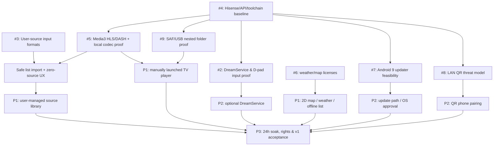

# OpenVista dependency frontier and P0 go/no-go checklist

**2026-10-25 review.** This is an **engineering plan**, not approval of a new product feature and not a report of completed testing. Preserve D-01–D-78.

## Critical path

## Independent research frontier (not all need TV access)

- [#3](https://github.com/murilaiooo/openvista/issues/3): define **user-managed stream and playlist imports** and how location/category metadata is handled. The application must ship with no media sources.
- [#6](https://github.com/murilaiooo/openvista/issues/6): official map/weather license + quota comparison can start without any APK.
- [#4](https://github.com/murilaiooo/openvista/issues/4): read-only Hisense/Windows toolchain baseline unlocks device-specific experiments.

## Device-dependent frontier (blocked by verified #4 baseline)

- [#2](https://github.com/murilaiooo/openvista/issues/2): DreamService input/idle. Actual support may be unsupported while manual app is still feasible.
- [#5](https://github.com/murilaiooo/openvista/issues/5): HLS/DASH and local video codec proof; user-managed playback needs validated source imports, permissions for test fixtures and actual playable streams.
- [#9 — SAF/USB](https://github.com/murilaiooo/openvista/issues/9): standalone measurable proof, because scoped folder picker and USB unplug are independent of DreamService.
- [#7](https://github.com/murilaiooo/openvista/issues/7): Android **9** package installer path. `SessionParams.setRequireUserAction` is **API 31+**, so do not build the Fire OS 7 implementation around it.
- [#8](https://github.com/murilaiooo/openvista/issues/8): LAN pairing threat model before opening a listener.

## Explicit stop/go rules

1. **No app code / test artifact gate:** currently NO APK; do not call docs/URL lookup a successful P0 prototype.
2. **Local first APK:** only on Hisense for development; it may have one permitted HLS/DASH and one local video, not 25 webcams. Label incomplete, do not publish binaries.
3. **Source gate:** release builds contain **zero bundled cameras, streaming playlists or video files**; user-added HLS/DASH and list import must work, including the no-sources empty state.
4. **DreamService gate:** if OEM blocks third-party selection, do not hack system settings or mark it supported; ship/continue manual Activity with clear limitation and obtain any necessary owner acceptance.
5. **Updater gate:** verified download must not be described as silent install. Android system confirmation remains mandatory where required.
6. **v1 quality gate:** define tolerances for 24h soak (frame drops, repeated buffering, memory creep, background work, crash and retry counts) *before* running it, based on initial hardware measurements.
7. **Release authorization:** seek user approval before first public GitHub APK, even after technical gates pass.

## Candidate user-facing seams for future tests

- **Scene selection:** public behavior is open a camera, skip failed camera, rotate and recover without black-loop.
- **Local media:** public behavior is browse allowed USB folders, play, 10-second seek, resume and safe unplug.
- **Dream input:** public behavior is eligible automatic activation, OK/Back/arrows and power-lifecycle exit or explicit unsupported.
- **Weather/map:** public behavior is a working seven-day forecast and 2D focus navigation, with visible no-data/offline states.
- **Package updater:** public behavior is verified update download followed by supported install or accurate user-confirmation prompt.

Architecture modules, data schemas and implementation SDK versions should be selected *after* relevant spikes, not by pure preference.
