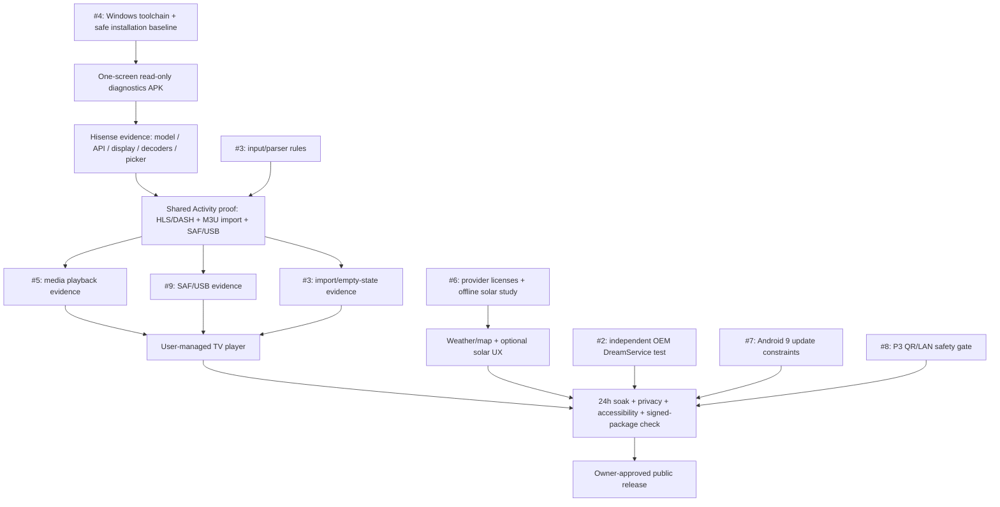

# OpenVista dependency frontier

**Revised 2026-10-25.** This is a test-first implementation sequence, not a record of device validation or a new product decision. Keep the 78 approved D-IDs and C-01 unchanged.

## First local APK critical path

A manual fullscreen Activity may confirm input focus. It **does not prove** that a third-party system DreamService can be selected, started by idle policy or receive its keys. #2 stays an independent device-gated investigation.

Using a single codebase/prototype for #3, #5 and #9 reduces setup and duplicate lifecycle code, but each issue needs **its own observed outcomes**, failure tests and reproducible evidence. Never close three issues because one video happened to play.

## Current independent streams of work

- **Diagnostic APK first:** isolate its own package, avoid changing the TV's existing apps and gather only non-sensitive OS-reported capabilities. Document how to export JSON through system UI; `persistedUriPermissions` only covers grants to that app. See [first-APK review](first-apk-sequencing-review-2026-10-25.md).
- **Direct URLs + user-selected M3U/USB:** eliminate a network listener from the prototype. Use SAF `ACTION_OPEN_DOCUMENT` for importing a list file and `ACTION_OPEN_DOCUMENT_TREE` separately for scanning local videos. Fire OS USB picker behavior is not yet proven; keep a keyboard fallback.
- **Solar computation:** approximate sunrise/sunset and daylight without an external weather call, when explicit camera coordinates exist. This does **not** replace weather forecasts or map tile licenses.
- **#8 QR/LAN:** scheduled in **P3 before a stable release that claims D-32/D-73**. No network listener or token system in first APK. It is deferred, not completed or silently removed.
- **Product experiments:** daylight/Golden Hour and display care remain optional P2 investigations. No procedural demo media or shader without new owner approval.

## Go / no-go rules

1. No APK/source currently exists at the start of this plan. Do not treat future proposal documents or PC `ffprobe` research as a completed Android prototype.
2. No privileged ADB install bypass, TV root, auto-launch at boot, forced screensaver or changes to unrelated installed apps.
3. The first APK is local only on Hisense 58U6HF / Fire OS 7. Other TV models remain unverified.
4. Release packages must contain no user-stream URLs, playlists or video files (C-01), checked on the actual signed artifact with [release guard](../testing/release-content-guard.md).
5. Unsupported OS, codec, USB picker, installer or DreamService capabilities must be labeled unsupported, not passed. Safe manual-app fallback is valid, but waiving an owner-approved stable-v1 feature requires explicit approval.
6. Set numeric baseline limits before the 24-hour stability run, with device, firmware, codecs, OS API, CPU/RAM, dropped frames and recovery evidence.
7. No GitHub binary release without explicit owner approval.

**Related:** [prioritized plan](priority-plan.md), [first-APK sequencing](first-apk-sequencing-review-2026-10-25.md), [v1 acceptance](../product/v1-acceptance.md), [owner decisions](../product/decisions.md).
