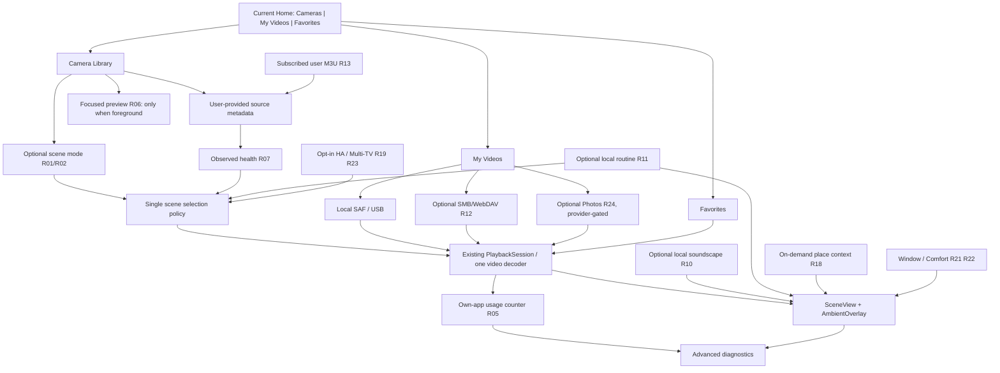

# Cross-feature architecture, dependency map, and five-pass research review

**Scope:** Documentation-only GitHub desk research, 2026-10-28. [Research epic #42](https://github.com/murilaiooo/openvista/issues/42) • [Draft PR #50](https://github.com/murilaiooo/openvista/pull/50) • [18 dossiers](dossiers/README.md). **Not a design approval or implementation order.**

## Product architecture map

The current app owns two distinct runtime families: **Cameras** (user-managed HLS/DASH, rotating live streams) and **Videos** (user-selected local/USB files). Both use one [PlaybackSession](../../player/src/main/java/com/openvista/prototype/playback/PlaybackSession.kt), one video decoder at a time, a shared [LibraryStore](../../player/src/main/java/com/openvista/prototype/library/LibraryStore.kt), a fullscreen [SceneView](../../player/src/main/java/com/openvista/prototype/ui/SceneView.kt), [PlayerScreen](../../player/src/main/java/com/openvista/prototype/ui/PlayerScreen.kt) and user-configured overlays. A new media **kind** (photo slideshow, RTSP live, MJPEG snapshots) must be modeled explicitly; assuming all URLs work as HLS corrupts semantics and recovery.



### High-leverage seams to consider only after a real prototype

| Seam | Owner of behavior | Existing alternative | Avoid premature architecture |
| --- | --- | --- | --- |
| **Scene candidate selection** | One pure selector integrated at `PlaybackSession.advance` | Existing queue/shuffle | Do not build cloud AI/rule engine |
| **Source identity and ingestion** | `LibraryStore` + parser, preserving stable IDs | M3U import, local SAF scans | Do not blend camera and video playlist semantics |
| **Source observation ledger** | Small local record updated by playback events | Current `Availability`/timestamp | Do not start background probe service |
| **Network file adapter** | A `DataSource` or media read seam that retains seeks | SAF / existing Media3 | Do not copy GPL competitor code into MIT |
| **Optional authorization** | Scoped provider connection with revoke/status | Existing local library/no account | No mandatory Google/HA login |
| **Route registry / state** | Current `LibraryRoute` dispatch and settings aliases | Existing View-based screens | Do not replatform to Compose |
| **Overlay/profile presets** | One visual settings policy, no player rebuild | Existing `AmbientOverlay` and display care | Avoid unnecessary shaders or fixed panels |

Deep module discipline: reuse a seam only when two real implementations need it; maintain small interface, test behavior through interface, never add speculative general-purpose registries. No modular refactor was performed.

## Real decision and dependency graph

```text
R27 Navigation audit ───────────────────> every user-facing proposal
R07 Observed Camera Health ──> R01 Smart Director <── R02 Solar filter
R11 Routines ────────────────> optional R01 mode + R22 Comfort preset
R26 Source protocol permissions ────────> camera input validation & R06 preview
R13 M3U subscription ───────────────────> stable source identity in LibraryStore
R12 Network library ────────────────────> optional R24 personal-media fallback
R24 Google Photos provider approval ────> optional external media picker
R19 Home Assistant security ────────┐
R23 Multi-TV pairing security ──────┴──> shared opt-in LAN command threat model
R21 Digital Window + R22 Comfort ───────> existing 32-phase display-care test
R05 Data Monitor ────────────────────────> own UID byte accounting, independent
R10 Soundscapes ─────────────────────────> audio lifecycle/focus (not video decoder)
R18 Place Discovery ─────────────────────> confirmed user source coordinates + provider terms
R25 YouTube ad-free auto-rotation ───────> NO-GO by current product requirement
```

**All arrows are hypotheses/dependency discussions, not approved change requests.** R05 and R02 can be researched independently of other work. R21/R22 must not regress the current display-care cycle. R19/R23 have no owner test path, so independent test environments are needed before product adoption.

## Five passes performed over repository research work

### Pass 1: Scope and coverage
The 14 exact user-selected item IDs are each represented by an individual Markdown dossier: R01, R02, R05, R06, R07, R10, R11, R12, R13, R18, R19, R21, R22, R23. Four additional subjects R24 (Google Photos), R25 (YouTube), R26 (camera protocols + supply), R27 (TV navigation) have separate dossiers. The four original program/IA/media/evidence documents remain. Index: [dossiers/README.md](dossiers/README.md). **Coverage is documentation coverage, not executed engineering coverage.**

### Pass 2: Current-code alignment and contradictory claims
Inspected `LibraryModels.kt`, `LibraryStore.kt`, `PlaybackSession.kt`, `PlayerScreen.kt`, `OpenVistaActivity.kt`, `LibraryScreens.kt`, `SettingsShell.kt`, `SettingsScreens.kt`, `UserSourceParser.kt`, `AmbientPlacement.kt`, plus status/decisions. Verified HLS/DASH-only camera kinds, 500-entry/1MiB M3U bounds, local one-player queue/fallback and seven Settings categories. **Corrected the original false `folders` route finding:** current `refresh()` explicitly handles it; changed the earlier IA doc and #49 issue. Other suspected focus/jank issues remain *research questions*, not diagnosed defects.

### Pass 3: Primary evidence provenance
Read GitHub sources for [Aerial Views](https://github.com/theothernt/AerialViews) (Samba/WebDAV and message overlays), [AndroidX Media](https://github.com/androidx/media), [go2rtc](https://github.com/AlexxIT/go2rtc) (RTSP and camera protocol reach), [MediaMTX](https://github.com/bluenviron/mediamtx) (WHEP, multi-protocol server), [Immich Android TV](https://github.com/giejay/Immich-Android-TV), and [Live Environment Streams](https://github.com/william-ricchiuti/Live-Environment-Streams) (unverified catalog size/quality). The latter's ~5,997 claim **is not a count of legally authorized OpenVista-ready streams**. External Google/YouTube/Android platform terms are linked for future direct verification and are **not represented as freshly fetched in this GitHub-only session**.

### Pass 4: Security, legality, user data, and device gates
Every new source/protocol must respect owner-managed media, no bundled URLs, credential secrecy, no app analytics, user consent, licensing, no ad bypass, no blanket LAN probes or remote code. The default app must work without Google, NAS, HA, two TVs, subscriptions or active weather. Physical Fire OS 7 codecs, 24-hour unattended soak, Google partner/OAuth, external provider policies and camera rights are **not tested**, remaining explicit gates. Draft PR only: no Java/Kotlin application files, APKs, secrets, README branding or OS settings changed.

### Pass 5: Interaction, dependency and editorial audit
All selected features are placed within existing 3-card Home and 7-section Settings taxonomy; the player retains contextual controls. Flagged risk of too many settings, hidden source provenance, over-specific claims about solar imagery, bandwidth accuracy and cosmetic panel power/burn-in effects. Each dossier distinguishes proposed targets from measured results, gives test cases and stop conditions, avoids vendor-unapproved claims, and has an explicit provisional verdict. The research docs include relative links and an index; **final changed-file/link verification still needs to be repeated whenever new files are added**.

## Evidence hierarchy and what was *not* done

- **E1:** GitHub source read, design sketches and third-party project claims, noted with limitations.
- **E2:** None; no Gradle/JVM test execution, mock API server or trial playback.
- **E3:** None; no Fire TV or other physical device was controlled.
- **E4:** None; no 24h stability, provider rights clearance, operational acceptance, legal review or signed release.
- **All user-selected features remain proposals.** Research “GO” never means implementation approval.

## Triaged next independent work (not automatically authorized)

1. Build **source-only simulated tests** for R02 solar calculations, R07 reliability ledger, R01 scene selection, R05 TrafficStats accounting and R11 fake clock routines, one isolated prototype at a time.
2. Run licensed synthetic server tests for R13 M3U subscriptions and R12 WebDAV/SMB; restrict streaming list input to explicit user-controlled sources.
3. Do a **sanctioned** real camera-format inventory before adding anything beyond HLS/DASH, and avoid overcounting HTML/YouTube entries.
4. Require independently authorized hardware/Google partnership or source permission evidence for R06/R19/R23/R24/R26. Do not ask the owner to test HA or multi-TV.
5. Reconcile any future screens against the owner's three original design references; no “fourth Home card” or additional duplicate settings route.
6. Request **explicit targeted owner approval only after research evidence**, not for this documentation work.

## PR review hazard / blast radius

- **Door:** two-way (documentation can be reverted).
- **Blast radius:** documents and issue planning only; no runtime code.
- **Risks:** readers may mistake research recommendations for approved requirements or third-party repository counts for verified legal streams. Labels, E-levels and linked source assumptions must accompany any future handoff.
- **Merge danger:** keep as draft until owner deliberately wants the research reference on main; never conflate documentation merge with feature sign-off.

## Addendum to pass 3: independent dataset implementation review

A deeper GitHub source-only check read [Live Environment Streams sources.json](https://github.com/william-ricchiuti/Live-Environment-Streams/blob/main/sources.json) and [scripts/validate.py](https://github.com/william-ricchiuti/Live-Environment-Streams/blob/main/scripts/validate.py). Dataset metadata tags 53/67 source families `fair_use` (not authorization); the public validator's HLS test is an HTTP 2xx request rather than full codec/live playback. Its separate claimed production validation was not reproduced. **Review implication:** no new camera protocol is justified by claimed record counts until legal usage and actual HD video playback are independently proved. The initial R26 dossier and media feasibility report were amended to state this explicitly.
